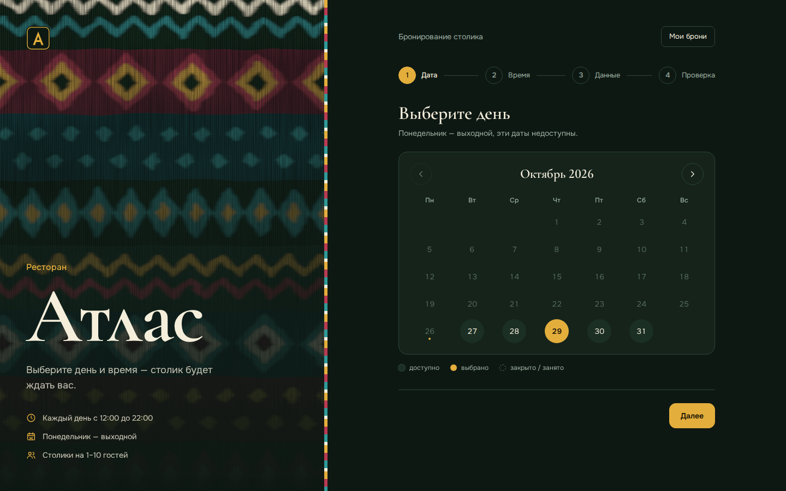

# Ресторан «Атлас» — бронирование столика

Веб-приложение для онлайн-бронирования столика в ресторане: пошаговый выбор даты и времени, форма с валидацией, подтверждение и список броней с возможностью отмены.

**Репозиторий:** https://github.com/sheralikuziyev4007/booking-app

<!-- Когда задеплоите на GitHub Pages, раскомментируйте эту строку:
**Демо:** https://sheralikuziyev4007.github.io/booking-app/
-->




## Возможности

- Четыре шага: дата → время → данные → проверка, затем экран подтверждения с номером брони.
- Календарь блокирует прошедшие даты, выходной день (понедельник) и полностью занятые дни.
- Для сегодняшней даты недоступны слоты, время которых уже прошло; после 22:00 сегодняшний день блокируется целиком.
- Слоты 12:00–22:00 с шагом 30 минут; занятые слоты отключаются.
- Валидация формы: имя, телефон, email, количество гостей (1–10).
- «Мои брони»: статусы «Предстоящая / Прошедшая / Отменена», отмена освобождает слот.
- Данные хранятся в `localStorage`, серверная часть не нужна.
- Адаптивный дизайн: на десктопе — две колонки (брендовая панель и форма), на телефоне — компактный баннер сверху.
- Фон левой панели — `src/assets/atlas-bg.svg` (узор «звезда» в духе узбекской майолики). Чтобы заменить фон, подставьте свой файл и поправьте импорт в `BrandPanel.jsx`.
- Доступность: подписи полей связаны с `input`, у иконок есть `aria-label`, видимый фокус с клавиатуры.

## Стек

React 18 (хуки) · Vite · Tailwind CSS · Vitest + Testing Library

Шрифты Cormorant Garamond и Onest подключены локально через Fontsource, без запросов к Google Fonts.

## Быстрый старт

Нужен Node.js 20.19+ или 22.12+.

```bash
git clone https://github.com/sheralikuziyev4007/booking-app.git
cd booking-app
npm install
npm run dev
```

Откройте адрес, который выведет Vite (обычно http://localhost:5173).

## Скрипты

| Команда           | Что делает                                   |
| ----------------- | -------------------------------------------- |
| `npm run dev`     | Запуск dev-сервера                           |
| `npm run build`   | Сборка для продакшена в папку `dist`         |
| `npm run preview` | Локальный просмотр собранной версии          |
| `npm test`        | Юнит-тесты утилит и интеграционный тест шагов бронирования |

## Структура проекта

```
src/
├── components/
│   ├── ui/                  // базовые переиспользуемые элементы
│   │   ├── Button.jsx       //   кнопка (варианты и размеры)
│   │   ├── Field.jsx        //   подпись + поле + текст ошибки
│   │   ├── Input.jsx        //   input / textarea с подсветкой ошибки
│   │   ├── Row.jsx          //   строка «подпись — значение»
│   │   ├── Icon.jsx         //   набор линейных иконок
│   │   ├── StepHeading.jsx  //   заголовок шага с подсказкой
│   │   └── StepTransition.jsx //  плавное появление шага
│   ├── BrandPanel.jsx       // брендовая панель: название, факты о ресторане
│   ├── (assets/atlas-bg.svg — фон панели «Атлас»)
│   ├── Logo.jsx             // знак ресторана
│   ├── Header.jsx           // шапка с кнопкой «Мои брони»
│   ├── Stepper.jsx          // индикатор шагов
│   ├── Calendar.jsx         // календарь месяца
│   ├── DayCell.jsx          // ячейка календаря
│   ├── TimeSlotGrid.jsx     // сетка временных слотов
│   ├── TimeSlotButton.jsx   // кнопка одного слота
│   ├── BookingForm.jsx      // форма с валидацией
│   ├── BookingSummary.jsx   // проверка данных перед подтверждением
│   ├── BookingSuccess.jsx   // экран успеха: бронь в виде билета с номером
│   ├── StepNavigation.jsx   // кнопки «Назад» / «Далее» / «Подтвердить»
│   ├── MyBookingsList.jsx   // список броней
│   └── BookingCard.jsx      // карточка одной брони
├── hooks/
│   └── useBookings.js       // брони: добавление, отмена, занятость слотов + localStorage
├── utils/
│   ├── dateHelpers.js       // даты, выходной день, прошедшие слоты, номер брони
│   ├── generateTimeSlots.js // генерация сетки слотов
│   ├── plural.js            // склонение: 1 гость, 2 гостя, 5 гостей
│   └── validation.js        // проверка полей формы
├── App.jsx
├── main.jsx
└── index.css
```

Тесты лежат рядом с кодом: `*.test.js` для утилит и `App.test.jsx` для полного сценария бронирования.

## Деплой на GitHub Pages

В репозитории уже есть workflow `.github/workflows/deploy.yml`: при пуше в `main` он запускает тесты, собирает проект и публикует его.

1. Загрузите проект в репозиторий на GitHub (ветка `main`).
2. Откройте **Settings → Pages** и в поле **Source** выберите **GitHub Actions**.
3. После завершения workflow сайт будет доступен по адресу `https://sheralikuziyev4007.github.io/booking-app/`.

Путь `base` для Vite задаётся переменной `VITE_BASE` (в workflow она равна `/<имя-репозитория>/`). Локально и на собственном домене используется `/`.

## Автор

Kuziyev Sherali — [GitHub](https://github.com/sheralikuziyev4007)

## Лицензия

[MIT](LICENSE) © Kuziyev Sherali
